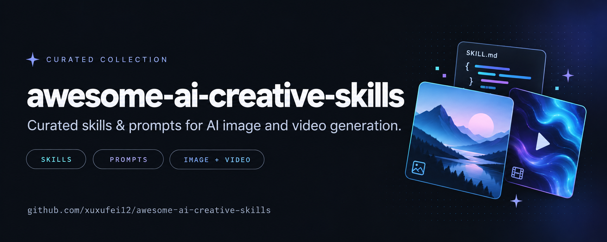

# Awesome AI Creative Skills

[English](README.md) · [简体中文](README.zh-CN.md)

> 把想法变成视频、图像、动效和三维世界的 Skill、Prompt、工具与作品资料库。

 

这里收录了一些用 AI 制作创意图片、视频、动效和 3D 场景的方法，包括可直接参考的提示词、可复用的 Skill，以及对应的作品效果。从一张有趣的图片到一段完整的动画，希望你能在这里找到灵感，也找到动手创作的起点。

**先看效果，再找做法。** 动图直接播放；点击喜欢的画面或卡片下方的「Skill」「提示词」，就能找到对应方法。

[先看知识与人物如何变成影像](#knowledge-and-biography) · [知识讲清楚，网页玩起来](#knowledge-and-play) · [代码做视频：从样片打开场景源码](#code-video-lab) · [11 月第二辑：月相、蜡笔图与九宫格表情](#november-picks-2) · [11 月精选：剪纸短片、生活感照片与聊天表情](#november-picks) · [直接看动图](#animated) · [创意图片与设计](#images) · [艺术动画与风格](#animation) · [3D 世界与产品视觉](#worlds) · [广告与商业短片](#ads) · [电影感与叙事短片](#films)

[浏览全部 2,103 个效果预览 →](gallery/README.md) · [按工具检索](#find-tools) · [自定义风格新玩法](#custom-styles)

## 先看知识与人物如何变成影像

[本期新增 12 个项目，按用途浏览 →](docs/new-2026-11-18-knowledge-biography.md)

<table>
<tr>
<td width="50%" valign="top" align="center"> <a href="projects/andyhuo520--vibe-knowledge.md"><b>商鞅立木：你会搬吗？</b></a> <a href="skills/572b94ce66f6c0e0.md">Skill</a> · <a href="https://github.com/andyhuo520/vibe-knowledge/releases/download/v1.0.0/ep01-shangyang.mp4">▶ 视频</a> · <a href="projects/andyhuo520--vibe-knowledge.md">制作方法</a> <a href="https://github.com/andyhuo520/vibe-knowledge/blob/c3a13a85f7cc560e5d396f063baecea4b2748e1e/README.md">andyhuo520/vibe-knowledge</a></td>
<td width="50%" valign="top" align="center"> <a href="projects/wchhywizd--vibe-knowledge-interactive.md"><b>生日悖论：先猜，再揭晓</b></a> <a href="skills/26b0183dc1744676.md">Skill</a> · <a href="https://raw.githubusercontent.com/wchhywizd/vibe-knowledge-interactive/240ec579c7b86d110ee7b6ad4bfc35193b0de52a/samples/%E8%AF%95%E7%89%87C-v2-%E5%90%8C%E4%B8%80%E5%A4%A9%E7%94%9F%E6%97%A5.mp4">▶ 视频</a> · <a href="projects/wchhywizd--vibe-knowledge-interactive.md">制作方法</a> <a href="https://github.com/wchhywizd/vibe-knowledge-interactive/blob/240ec579c7b86d110ee7b6ad4bfc35193b0de52a/README.md">wchhywizd/vibe-knowledge-interactive</a></td>
</tr>
<tr>
<td width="50%" valign="top" align="center"> <a href="projects/aliangsss--aliang-knowledge-video.md"><b>墨菲定律的案件墙</b></a> <a href="skills/03f8500000acf000.md">Skill</a> · <a href="projects/aliangsss--aliang-knowledge-video.md">制作方法</a> <a href="https://github.com/aliangSSS/aliang-knowledge-video/blob/1687e5e87539b98a25289d76e1f935ea48787929/README.md">aliangSSS/aliang-knowledge-video</a></td>
<td width="50%" valign="top" align="center"> <a href="projects/gui-lin--vibe-knowledge-studio.md"><b>概率在眼前形成</b></a> <a href="skills/2d1feb612f950602.md">Skill</a> · <a href="projects/gui-lin--vibe-knowledge-studio.md">制作方法</a> <a href="https://github.com/gui-lin/vibe-knowledge-studio/blob/326691a863fd4eddbd487ae8e6786bf1d87d5e03/README.md">gui-lin/vibe-knowledge-studio</a></td>
</tr>
<tr>
<td width="50%" valign="top" align="center"> <a href="projects/nailcore--create-chinese-ink-video.md"><b>水墨人物显影片段</b></a> <a href="skills/22da64673847e4ed.md">Skill</a> · <a href="https://raw.githubusercontent.com/Nailcore/create-chinese-ink-video/e2318a55343f91247037f23aba4534cd14d435b4/examples/musk-fluid-ink/musk-fluid-ink-v11.mp4">▶ 视频</a> · <a href="projects/nailcore--create-chinese-ink-video.md">制作方法</a> <a href="https://github.com/Nailcore/create-chinese-ink-video/blob/e2318a55343f91247037f23aba4534cd14d435b4/README.md">Nailcore/create-chinese-ink-video</a></td>
<td width="50%" valign="top" align="center"> <a href="projects/bangbuilds--code-poem-film.md"><b>苏轼词作的动画章节</b></a> <a href="skills/a493671b951221d4.md">Skill</a> · <a href="projects/bangbuilds--code-poem-film.md">制作方法</a> <a href="https://github.com/bangbuilds/code-poem-film/blob/8530dafb2786cdd724451f5503934507624b18c1/README.md">bangbuilds/code-poem-film</a></td>
</tr>
</table>

[继续按效果挑选 →](gallery/README.md)

## 知识讲清楚，网页玩起来

[本期新增 14 个项目，按用途浏览 →](docs/new-2026-11-18-knowledge-html.md)

<table>
<tr>
<td width="50%" valign="top" align="center"> <a href="projects/yt-smart--vibe-knowledge-video.md"><b>落珠如何堆出运气的形状</b></a> <a href="skills/e5ea1b0ae74c7020.md">Skill</a> · <a href="https://raw.githubusercontent.com/YT-smart/vibe-knowledge-video/6dddf51ad112f5533f4d474c6641a6cdeca36689/demos/claude.gif">原动图</a> · <a href="projects/yt-smart--vibe-knowledge-video.md">制作方法</a> <a href="https://github.com/YT-smart/vibe-knowledge-video/blob/6dddf51ad112f5533f4d474c6641a6cdeca36689/README.md">YT-smart/vibe-knowledge-video</a></td>
<td width="50%" valign="top" align="center"> <a href="projects/steseven--vibe-make.md"><b>古人怎么刷牙</b></a> <a href="skills/cb86d81387640163.md">Skill</a> · <a href="projects/steseven--vibe-make.md">制作方法</a> <a href="https://github.com/steseven/vibe-make/blob/cea769d015ba31a46c85ec8237454b4465e78386/README.md">steseven/vibe-make</a></td>
</tr>
<tr>
<td width="50%" valign="top" align="center"> <a href="projects/thiernoyunus--stick-reel.md"><b>让火柴人真的参与解释</b></a> <a href="skills/c12fbba6da0d967d.md">Skill</a> · <a href="projects/thiernoyunus--stick-reel.md">制作方法</a> <a href="https://github.com/thiernoyunus/stick-reel/blob/1fff5db51376e4415aab7505c5cf60c9612e3a0d/README.md">thiernoyunus/stick-reel</a></td>
<td width="50%" valign="top" align="center"> <a href="projects/mantou2046--onepager-explainer.md"><b>拖动滑杆读懂 LoRA</b></a> <a href="skills/c873e0151c6ef290.md">Skill</a> · <a href="projects/mantou2046--onepager-explainer.md">制作方法</a> <a href="https://github.com/mantou2046/onepager-explainer/blob/948e1560c5a4279ee0ac5492b4e198aa6cda27e8/README.md">mantou2046/onepager-explainer</a></td>
</tr>
<tr>
<td width="50%" valign="top" align="center"> <a href="projects/d-sup--sim-diorama-skill.md"><b>夜景赛车与像素小镇</b></a> <a href="skills/0c6873c7877069c3.md">Skill</a> · <a href="https://raw.githubusercontent.com/D-Sup/sim-diorama-skill/aa6413bf78d6ca6e49e523dc65ebc1ffe9c37278/media/marina-gp.gif">原动图</a> · <a href="projects/d-sup--sim-diorama-skill.md">制作方法</a> <a href="https://github.com/D-Sup/sim-diorama-skill/blob/aa6413bf78d6ca6e49e523dc65ebc1ffe9c37278/README.md">D-Sup/sim-diorama-skill</a></td>
<td width="50%" valign="top" align="center"> <a href="projects/airsuphq--machine-skill.md"><b>在网页里研究涡扇发动机</b></a> <a href="skills/1f71d2c90c9b1c0c.md">Skill</a> · <a href="projects/airsuphq--machine-skill.md">制作方法</a> <a href="https://github.com/AirsupHQ/machine-skill/blob/e0bd066ac5beaf48512935de2fc0f0e55636853a/README.md">AirsupHQ/machine-skill</a></td>
</tr>
<tr>
<td width="50%" valign="top" align="center"> <a href="projects/asashades--asa-slides.md"><b>按方向键拆开三维物件</b></a> <a href="skills/f4389b704306b898.md">Skill</a> · <a href="https://asashades.github.io/asa-slides/galeri-explainer.html">在线体验</a> · <a href="projects/asashades--asa-slides.md">制作方法</a> <a href="https://github.com/asashades/asa-slides/blob/f153f6b54286af87e58119066b22dc943ac6d281/README.md">asashades/asa-slides</a></td>
<td width="50%" valign="top" align="center"> <a href="projects/k-sandhu--visual-explainer-skills.md"><b>先猜结果，再调参数</b></a> <a href="skills/b69d7441a1d8d051.md">Skill</a> · <a href="https://raw.githubusercontent.com/k-sandhu/visual-explainer-skills/807d99e619233f37a6e1519ddb88a2c77f33bcb6/examples/27-adaptive-knowledge-rollouts/explainer.gif">原动图</a> · <a href="projects/k-sandhu--visual-explainer-skills.md">制作方法</a> <a href="https://github.com/k-sandhu/visual-explainer-skills/blob/807d99e619233f37a6e1519ddb88a2c77f33bcb6/README.md">k-sandhu/visual-explainer-skills</a></td>
</tr>
</table>

[继续按效果挑选 →](gallery/README.md)

## 代码做视频：从样片打开场景源码

[本期新增 10 个项目，按用途浏览 →](docs/new-2026-11-13-code-video.md)

<table>
<tr>
<td width="50%" valign="top" align="center"> <a href="projects/leodavincs--kalem.md"><b>让机械图纸动起来</b></a> <a href="skills/a1b245b49c218cf3.md">Skill</a> · <a href="https://raw.githubusercontent.com/leodavincs/kalem/ba19c9f20b816ab00c8bb3445e3ddf597f26ae6d/motorlar/levha/demo.gif">原动图</a> · <a href="https://github.com/leodavincs/kalem/blob/ba19c9f20b816ab00c8bb3445e3ddf597f26ae6d/motorlar/levha/mekanizma.py">场景源码</a> · <a href="projects/leodavincs--kalem.md">制作方法</a> <a href="https://github.com/leodavincs/kalem/blob/ba19c9f20b816ab00c8bb3445e3ddf597f26ae6d/README.md">leodavincs/kalem</a></td>
<td width="50%" valign="top" align="center"> <a href="projects/syedbahjat--claude-stickman-shorts.md"><b>末班地铁火柴人短剧</b></a> <a href="skills/50af05b2ef94f71c.md">Skill</a> · <a href="https://raw.githubusercontent.com/SyedBahjat/claude-stickman-shorts/2fb64aa5c3e8a1df59a7cdd1651126cdc9cc2d9e/assets/lasttrain-p1.gif">原动图</a> · <a href="https://github.com/SyedBahjat/claude-stickman-shorts/blob/2fb64aa5c3e8a1df59a7cdd1651126cdc9cc2d9e/src/stories/last-train/LastTrainP1.tsx">场景源码</a> · <a href="projects/syedbahjat--claude-stickman-shorts.md">制作方法</a> <a href="https://github.com/SyedBahjat/claude-stickman-shorts/blob/2fb64aa5c3e8a1df59a7cdd1651126cdc9cc2d9e/README.md">SyedBahjat/claude-stickman-shorts</a></td>
</tr>
<tr>
<td width="50%" valign="top" align="center"> <a href="projects/mojomast--hyperrizz.md"><b>像素电视台包装</b></a> <a href="skills/a966fa6550880f7a.md">Skill</a> · <a href="https://github.com/mojomast/hyperrizz/blob/35c482e22413ee43c74955bd6da7fe7b053cdd9b/templates/broadcast-lab/scenes/01-signal.js">场景源码</a> · <a href="projects/mojomast--hyperrizz.md">制作方法</a> <a href="https://github.com/mojomast/hyperrizz/blob/35c482e22413ee43c74955bd6da7fe7b053cdd9b/README.md">mojomast/hyperrizz</a></td>
<td width="50%" valign="top" align="center"> <a href="projects/6space7--autozoom-demo-skill.md"><b>自动推近的软件演示</b></a> <a href="skills/02b5b55a573e6b7b.md">Skill</a> · <a href="https://github.com/6space7/autozoom-demo-skill/blob/75ed2192a2272b2c4181eaec61888111763e0b10/skills/autozoom-demo-scenes/assets/remotion-template/src/Demo.tsx">场景源码</a> · <a href="projects/6space7--autozoom-demo-skill.md">制作方法</a> <a href="https://github.com/6space7/autozoom-demo-skill/blob/75ed2192a2272b2c4181eaec61888111763e0b10/README.md">6space7/autozoom-demo-skill</a></td>
</tr>
<tr>
<td width="50%" valign="top" align="center"> <a href="projects/artemnovitckii--claude-animation-skills.md"><b>从家到健身房的路线动画</b></a> <a href="skills/4d87472c022889d1.md">Skill</a> · <a href="https://github.com/artemnovitckii/claude-animation-skills/blob/5dbea55c23aa6a5c93dc3cfb5583840513b56b94/skills/map-route/template.html">场景源码</a> · <a href="projects/artemnovitckii--claude-animation-skills.md">制作方法</a> <a href="https://github.com/artemnovitckii/claude-animation-skills/blob/5dbea55c23aa6a5c93dc3cfb5583840513b56b94/README.md">artemnovitckii/claude-animation-skills</a></td>
<td width="50%" valign="top" align="center"> <a href="projects/brewed-ops--talking-explainer.md"><b>会对口型的卡通讲解员</b></a> <a href="skills/1178f2b0fe6ee9e3.md">Skill</a> · <a href="https://raw.githubusercontent.com/brewed-ops/talking-explainer/3a19bbce0c97dcdd3120c7e3c4b10ddc3e13f1d5/docs/talking.gif">原动图</a> · <a href="https://github.com/brewed-ops/talking-explainer/blob/3a19bbce0c97dcdd3120c7e3c4b10ddc3e13f1d5/skills/talking-explainer/template/apple/scene-starter.html">场景源码</a> · <a href="projects/brewed-ops--talking-explainer.md">制作方法</a> <a href="https://github.com/brewed-ops/talking-explainer/blob/3a19bbce0c97dcdd3120c7e3c4b10ddc3e13f1d5/README.md">brewed-ops/talking-explainer</a></td>
</tr>
</table>

[继续按效果挑选 →](gallery/README.md)

## 11 月第二辑：月相、蜡笔图与九宫格表情

[本期新增 12 个项目，按用途浏览 →](docs/new-2026-11-13-round-2.md)

<table>
<tr>
<td width="50%" valign="top" align="center"> <a href="projects/seeyouintokyo--science-video-skill.md"><b>用代码画月相</b></a> <a href="skills/f8d24f7f7eba21b7.md">Skill</a> · <a href="https://raw.githubusercontent.com/seeyouintokyo/science-video-skill/0659cb177534acad5142da3f9d57f31205bf64f6/assets/moon-full.gif">原动图</a> · <a href="projects/seeyouintokyo--science-video-skill.md">制作方法</a> <a href="https://github.com/seeyouintokyo/science-video-skill/blob/0659cb177534acad5142da3f9d57f31205bf64f6/README.md">seeyouintokyo/science-video-skill</a></td>
<td width="50%" valign="top" align="center"> <a href="projects/deenukhan--animation-styles.md"><b>一壶茶的 39 种画风</b></a> <a href="skills/5900200d9c986e33.md">Skill</a> · <a href="projects/deenukhan--animation-styles.md">制作方法</a> <a href="https://github.com/deenukhan/animation-styles/blob/7f7afbd4c5a216135e51be354cb245dcfabedb3a/README.md">deenukhan/animation-styles</a></td>
</tr>
<tr>
<td width="50%" valign="top" align="center"> <a href="projects/deer-flow--crayon-diagrams.md"><b>手机上能读的蜡笔技术图</b></a> <a href="skills/56b76e62a6e5e753.md">Skill</a> · <a href="projects/deer-flow--crayon-diagrams.md">制作方法</a> <a href="https://github.com/deer-flow/crayon-diagrams/blob/c3a2b6c265123f64c5b16b991d1ef9699ad0d80f/README.md">deer-flow/crayon-diagrams</a></td>
<td width="50%" valign="top" align="center"> <a href="projects/kers701--bride-series-skill.md"><b>同一角色的旗袍婚纱变体</b></a> <a href="skills/a83c5352d036dbb0.md">Skill</a> · <a href="projects/kers701--bride-series-skill.md">制作方法</a> <a href="https://github.com/kers701/bride-series-skill/blob/b2d48ec268d4230d0fc075d5320c7003e0a366b9/README.md">kers701/bride-series-skill</a></td>
</tr>
<tr>
<td width="50%" valign="top" align="center"> <a href="projects/daaihq--da-motion-sticker-skill.md"><b>九宫格角色动图</b></a> <a href="skills/ecc57610e6f2ffea.md">Skill</a> · <a href="https://raw.githubusercontent.com/daaihq/da-motion-sticker-skill/909241387830a83b91e11d553cb2efafdcc897db/assets/preview_gif/01.gif">原动图</a> · <a href="projects/daaihq--da-motion-sticker-skill.md">制作方法</a> <a href="https://github.com/daaihq/da-motion-sticker-skill/blob/909241387830a83b91e11d553cb2efafdcc897db/README.md">daaihq/da-motion-sticker-skill</a></td>
<td width="50%" valign="top" align="center"> <a href="projects/aimanplay--manman-ai-sticker.md"><b>算法人的聊天表情</b></a> <a href="skills/28f96b6d3f3d5317.md">Skill</a> · <a href="https://raw.githubusercontent.com/aimanplay/manman-ai-sticker/f60c2011c8addb6e4f2bb73a5640525ce70e80bc/assets/%E7%A4%BA%E4%BE%8B_B_%E5%A4%8D%E7%8E%B0%E4%BA%86_240.gif">原动图</a> · <a href="projects/aimanplay--manman-ai-sticker.md">制作方法</a> <a href="https://github.com/aimanplay/manman-ai-sticker/blob/f60c2011c8addb6e4f2bb73a5640525ce70e80bc/README.md">aimanplay/manman-ai-sticker</a></td>
</tr>
</table>

[继续按效果挑选 →](gallery/README.md)

## 11 月精选：剪纸短片、生活感照片与聊天表情

[本期新增 15 个项目，按用途浏览 →](docs/new-2026-11-13.md)

<table>
<tr>
<td width="50%" valign="top" align="center"> <a href="projects/cooperchx--paper-cutout-story.md"><b>上海剪纸 Citywalk</b></a> <a href="skills/b88bd11f4f3a7ddf.md">Skill</a> · <a href="https://raw.githubusercontent.com/cooperchx/paper-cutout-story/9899d4dd52352ff0ed656226041cdb6a7aafcbca/media/gifs/shanghai-v2.gif">原动图</a> · <a href="projects/cooperchx--paper-cutout-story.md">制作方法</a> <a href="https://github.com/cooperchx/paper-cutout-story/blob/9899d4dd52352ff0ed656226041cdb6a7aafcbca/README.md">cooperchx/paper-cutout-story</a></td>
<td width="50%" valign="top" align="center"> <a href="projects/fantuan-lab--animated-sticker-studio.md"><b>会说「收到」的饭团猫</b></a> <a href="skills/bad6f6344e488fcf.md">Skill</a> · <a href="https://raw.githubusercontent.com/fantuan-lab/animated-sticker-studio/b74963f80b365865c41ed1b2664f5abcda4efab2/examples/onigiri-cat/gif/001-%E6%94%B6%E5%88%B0.gif">原动图</a> · <a href="projects/fantuan-lab--animated-sticker-studio.md">制作方法</a> <a href="https://github.com/fantuan-lab/animated-sticker-studio/blob/b74963f80b365865c41ed1b2664f5abcda4efab2/README.md">fantuan-lab/animated-sticker-studio</a></td>
</tr>
<tr>
<td width="50%" valign="top" align="center"> <a href="projects/howoneai--xiaolin-explainer-packaging.md"><b>地图上的财经讲解</b></a> <a href="skills/f651b783efaab55e.md">Skill</a> · <a href="https://raw.githubusercontent.com/howoneai/xiaolin-explainer-packaging/e304b066e281a2ab79fe07be65c0aaac2a45315e/docs/demo_map.gif">原动图</a> · <a href="projects/howoneai--xiaolin-explainer-packaging.md">制作方法</a> <a href="https://github.com/howoneai/xiaolin-explainer-packaging/blob/e304b066e281a2ab79fe07be65c0aaac2a45315e/README.md">howoneai/xiaolin-explainer-packaging</a></td>
<td width="50%" valign="top" align="center"> <a href="projects/sanshengai--sansheng-image.md"><b>同一画风的文章插图</b></a> <a href="skills/e7e4bf72e3c048d3.md">Skill</a> · <a href="projects/sanshengai--sansheng-image.md">制作方法</a> <a href="https://github.com/sanshengai/sansheng-image/blob/d65a0dd2639f13a5881654be6a00b40b60bc8467/README.md">sanshengai/sansheng-image</a></td>
</tr>
<tr>
<td width="50%" valign="top" align="center"> <a href="projects/lortbyron--gpt-image-realism-engine.md"><b>生活感街拍</b></a> <a href="skills/6ce608535788fdd7.md">Skill</a> · <a href="projects/lortbyron--gpt-image-realism-engine.md">制作方法</a> <a href="https://github.com/Lortbyron/gpt-image-realism-engine/blob/4176e06a7d27ba88a5d4369bd9fb58525ef99204/README.md">Lortbyron/gpt-image-realism-engine</a></td>
<td width="50%" valign="top" align="center"> <a href="projects/alchaincyf--huashu-selfie-sticker.md"><b>自拍变成八个小表情</b></a> <a href="skills/aeb34f4da6df73dd.md">Skill</a> · <a href="https://raw.githubusercontent.com/alchaincyf/huashu-selfie-sticker/c55236fe943d2804d033c3d5c877de5525785dcd/assets/demo.gif">原动图</a> · <a href="projects/alchaincyf--huashu-selfie-sticker.md">制作方法</a> <a href="https://github.com/alchaincyf/huashu-selfie-sticker/blob/c55236fe943d2804d033c3d5c877de5525785dcd/README.md">alchaincyf/huashu-selfie-sticker</a></td>
</tr>
</table>

[继续按效果挑选 →](gallery/README.md)

## 直接看动图

<table>
<tr>
<td width="50%" valign="top" align="center"> <a href="projects/alchaincyf--huashu-motion.md"><b>产品宣传片</b></a> <a href="skills/fb114d4dfacbe64a.md">Skill</a> · <a href="https://raw.githubusercontent.com/alchaincyf/huashu-motion/52467f99c602b76ba86d511d37acdfe93fa1e16e/docs/media/hero.gif">原动图</a> · <a href="projects/alchaincyf--huashu-motion.md">制作方法</a> <a href="https://github.com/alchaincyf/huashu-motion/blob/52467f99c602b76ba86d511d37acdfe93fa1e16e/README.md">alchaincyf/huashu-motion</a></td>
<td width="50%" valign="top" align="center"> <a href="projects/haidrrrry--claude-remotion-skill.md"><b>Remotion 动效</b></a> <a href="skills/7bc57dcc03c9812f.md">Skill</a> · <a href="https://raw.githubusercontent.com/haidrrrry/claude-remotion-skill/1dcbe5e3fc6cf970bd10d3cc05f0a8a5d19d0383/demo.gif">原动图</a> · <a href="projects/haidrrrry--claude-remotion-skill.md">制作方法</a> <a href="https://github.com/haidrrrry/claude-remotion-skill/blob/1dcbe5e3fc6cf970bd10d3cc05f0a8a5d19d0383/README.md">haidrrrry/claude-remotion-skill</a></td>
</tr>
<tr>
<td width="50%" valign="top" align="center"> <a href="projects/alentodorov--create-promo-video.md"><b>宣传短片</b></a> <a href="skills/efe5f940dc3b8a08.md">Skill</a> · <a href="https://raw.githubusercontent.com/alentodorov/create-promo-video/3e7689fb09cd67633c352dc1bbca5cb35bd602a2/promo.gif">原动图</a> · <a href="projects/alentodorov--create-promo-video.md">制作方法</a> <a href="https://github.com/alentodorov/create-promo-video/blob/3e7689fb09cd67633c352dc1bbca5cb35bd602a2/README.md">alentodorov/create-promo-video</a></td>
<td width="50%" valign="top" align="center"> <a href="projects/alchaincyf--huashu-art-motion.md"><b>艺术动画</b></a> <a href="skills/df73e57c621425a8.md">Skill</a> · <a href="https://raw.githubusercontent.com/alchaincyf/huashu-art-motion/8a0d7d72ca65fcce6f8ba82c4a6c8dfe35b8422c/assets/showcase/mario-claude.gif">原动图</a> · <a href="projects/alchaincyf--huashu-art-motion.md">制作方法</a> <a href="https://github.com/alchaincyf/huashu-art-motion/blob/8a0d7d72ca65fcce6f8ba82c4a6c8dfe35b8422c/README.md">alchaincyf/huashu-art-motion</a></td>
</tr>
<tr>
<td width="50%" valign="top" align="center"> <a href="projects/av-simi2--claude-manim-skill.md"><b>无人机定位讲解</b></a> <a href="skills/fbb4248acf8a5ed3.md">Skill</a> · <a href="https://raw.githubusercontent.com/av-simi2/claude-manim-skill/f87274763f7416214899507fce6e55248fca2696/assets/demo.gif">原动图</a> · <a href="projects/av-simi2--claude-manim-skill.md">制作方法</a> <a href="https://github.com/av-simi2/claude-manim-skill/blob/f87274763f7416214899507fce6e55248fca2696/README.md">av-simi2/claude-manim-skill</a></td>
<td width="50%" valign="top" align="center"> <a href="projects/yusuke710--manim-skill.md"><b>数学可视化</b></a> <a href="skills/40ffbd7dc500a0e4.md">Skill</a> · <a href="https://raw.githubusercontent.com/Yusuke710/manim-skill/a0048d9e265499038f34a9aa58ff16d306b5034c/manim_skill.gif">原动图</a> · <a href="projects/yusuke710--manim-skill.md">制作方法</a> <a href="https://github.com/Yusuke710/manim-skill/blob/a0048d9e265499038f34a9aa58ff16d306b5034c/README.md">Yusuke710/manim-skill</a></td>
</tr>
<tr>
<td width="50%" valign="top" align="center"> <a href="projects/finderchangchang--brewreel.md"><b>Brewreel 成片</b></a> <a href="skills/42eb72828d75aeb3.md">Skill</a> · <a href="https://raw.githubusercontent.com/Finderchangchang/brewreel/217eb1f9c6c047b908bfa95ec03f729bec1247ce/docs/images/readme-hero.gif">原动图</a> · <a href="projects/finderchangchang--brewreel.md">制作方法</a> <a href="https://github.com/Finderchangchang/brewreel/blob/217eb1f9c6c047b908bfa95ec03f729bec1247ce/README.md">Finderchangchang/brewreel</a></td>
<td width="50%" valign="top" align="center"> <a href="projects/gamezxz--pixel-art-studio.md"><b>像素水豚行走</b></a> <a href="skills/3aea3d2fb63a1027.md">Skill</a> · <a href="https://raw.githubusercontent.com/Gamezxz/pixel-art-studio/f8c246635c4621a6c2b427833149afdc3dc3c719/docs/assets/capy_walk_down.gif">原动图</a> · <a href="projects/gamezxz--pixel-art-studio.md">制作方法</a> <a href="https://github.com/Gamezxz/pixel-art-studio/blob/f8c246635c4621a6c2b427833149afdc3dc3c719/README.md">Gamezxz/pixel-art-studio</a></td>
</tr>
<tr>
<td width="50%" valign="top" align="center"> <a href="projects/molauu--svg-character-animator.md"><b>SVG 角色动画</b></a> <a href="skills/e48627f8dda9e1bd.md">Skill</a> · <a href="https://raw.githubusercontent.com/molauu/svg-character-animator/5ee1e7845caefe2c9ab51c64a2aa6f386e72ef5b/assets/readme/critter.gif">原动图</a> · <a href="projects/molauu--svg-character-animator.md">制作方法</a> <a href="https://github.com/molauu/svg-character-animator/blob/5ee1e7845caefe2c9ab51c64a2aa6f386e72ef5b/README.md">molauu/svg-character-animator</a></td>
<td width="50%" valign="top" align="center"> <a href="projects/whaleyxbt--claude-motion.md"><b>3D 爬行生物</b></a> <a href="projects/whaleyxbt--claude-motion.md">Skill 包</a> · <a href="https://raw.githubusercontent.com/whaleyxbt/claude-motion/e627941543d9988b155dc610bb9cc0115a5e365e/media/sims/crawlers.gif">原动图</a> · <a href="projects/whaleyxbt--claude-motion.md">制作方法</a> <a href="https://github.com/whaleyxbt/claude-motion/blob/e627941543d9988b155dc610bb9cc0115a5e365e/README.md">whaleyxbt/claude-motion</a></td>
</tr>
<tr>
<td width="50%" valign="top" align="center"> <a href="projects/alchaincyf--huashu-motion.md"><b>指着画面改动效</b></a> <a href="skills/fb114d4dfacbe64a.md">Skill</a> · <a href="https://raw.githubusercontent.com/alchaincyf/huashu-motion/52467f99c602b76ba86d511d37acdfe93fa1e16e/docs/media/point-to-edit.gif">原动图</a> · <a href="projects/alchaincyf--huashu-motion.md">制作方法</a> <a href="https://github.com/alchaincyf/huashu-motion/blob/52467f99c602b76ba86d511d37acdfe93fa1e16e/README.md">alchaincyf/huashu-motion</a></td>
<td width="50%" valign="top" align="center"> <a href="projects/haidrrrry--claude-remotion-skill.md"><b>Focus Cat 产品片</b></a> <a href="skills/7bc57dcc03c9812f.md">Skill</a> · <a href="https://raw.githubusercontent.com/haidrrrry/claude-remotion-skill/1dcbe5e3fc6cf970bd10d3cc05f0a8a5d19d0383/examples/videos/focus-cat.gif">原动图</a> · <a href="projects/haidrrrry--claude-remotion-skill.md">制作方法</a> <a href="https://github.com/haidrrrry/claude-remotion-skill/blob/1dcbe5e3fc6cf970bd10d3cc05f0a8a5d19d0383/README.md">haidrrrry/claude-remotion-skill</a></td>
</tr>
</table>

[继续按效果挑选 →](gallery/README.md)

## 创意图片与设计

<table>
<tr>
<td width="33%" valign="top" align="center"> <a href="prompts/bbb05d8c5c1fd2f7.md"><b>城市美食地图</b></a> <a href="prompts/bbb05d8c5c1fd2f7.md">提示词</a> <a href="https://github.com/YouMind-OpenLab/awesome-gpt-image-2/blob/e370b74e0d465dd72607b19ca0590735a08f927d/README.md#L236">YouMind-OpenLab/awesome-gpt-image-2</a></td>
<td width="33%" valign="top" align="center"> <a href="prompts/82b5eeb6e0f590d3.md"><b>蓬松毛绒玩具</b></a> <a href="prompts/82b5eeb6e0f590d3.md">提示词</a> <a href="https://github.com/PicoTrex/Awesome-Nano-Banana-images/blob/2558bf0bb825be150c5d1aeab918cd90004882d3/README.md#L513">PicoTrex/Awesome-Nano-Banana-images</a></td>
<td width="33%" valign="top" align="center"> <a href="prompts/02656caaa655f456.md"><b>浮世绘闪卡</b></a> <a href="prompts/02656caaa655f456.md">提示词</a> <a href="https://github.com/PicoTrex/Awesome-Nano-Banana-images/blob/2558bf0bb825be150c5d1aeab918cd90004882d3/README.md#L224">PicoTrex/Awesome-Nano-Banana-images</a></td>
</tr>
<tr>
<td width="33%" valign="top" align="center"> <a href="prompts/651e78dab7a4f399.md"><b>丝绸宇宙</b></a> <a href="prompts/651e78dab7a4f399.md">提示词</a> <a href="https://github.com/jamez-bondos/awesome-gpt4o-images/blob/3ed4dbb0f1ae6f7385c81e1fcea48d9eefd2e596/README.md#L1043">jamez-bondos/awesome-gpt4o-images</a></td>
<td width="33%" valign="top" align="center"> <a href="prompts/7b0f59ebdaae14ea.md"><b>冰棒里的水下世界</b></a> <a href="prompts/7b0f59ebdaae14ea.md">提示词</a> <a href="https://github.com/jamez-bondos/awesome-gpt4o-images/blob/3ed4dbb0f1ae6f7385c81e1fcea48d9eefd2e596/README.md#L1066">jamez-bondos/awesome-gpt4o-images</a></td>
<td width="33%" valign="top" align="center"> <a href="prompts/e24095a21fad2a6e.md"><b>蒸汽朋克机械鱼</b></a> <a href="prompts/e24095a21fad2a6e.md">提示词</a> <a href="https://github.com/jamez-bondos/awesome-gpt4o-images/blob/3ed4dbb0f1ae6f7385c81e1fcea48d9eefd2e596/README.md#L1087">jamez-bondos/awesome-gpt4o-images</a></td>
</tr>
<tr>
<td width="33%" valign="top" align="center"> <a href="prompts/c59d105455d72b08.md"><b>城市冰箱贴</b></a> <a href="prompts/c59d105455d72b08.md">提示词</a> <a href="https://github.com/PicoTrex/Awesome-Nano-Banana-images/blob/2558bf0bb825be150c5d1aeab918cd90004882d3/README.md#L1004">PicoTrex/Awesome-Nano-Banana-images</a></td>
<td width="33%" valign="top" align="center"> <a href="prompts/1866c6c531688d17.md"><b>Q 版微缩概念店</b></a> <a href="prompts/1866c6c531688d17.md">提示词</a> <a href="https://github.com/PicoTrex/Awesome-Nano-Banana-images/blob/2558bf0bb825be150c5d1aeab918cd90004882d3/README.md#L1064">PicoTrex/Awesome-Nano-Banana-images</a></td>
<td width="33%" valign="top" align="center"> <a href="prompts/95e4062ca861fd15.md"><b>水晶质感 Emoji</b></a> <a href="prompts/95e4062ca861fd15.md">提示词</a> <a href="https://github.com/PicoTrex/Awesome-Nano-Banana-images/blob/2558bf0bb825be150c5d1aeab918cd90004882d3/README.md#L526">PicoTrex/Awesome-Nano-Banana-images</a></td>
</tr>
<tr>
<td width="33%" valign="top" align="center"> <a href="prompts/1c52381f78500e3b.md"><b>玻璃质感重塑</b></a> <a href="prompts/1c52381f78500e3b.md">提示词</a> <a href="https://github.com/jamez-bondos/awesome-gpt4o-images/blob/3ed4dbb0f1ae6f7385c81e1fcea48d9eefd2e596/README.md#L344">jamez-bondos/awesome-gpt4o-images</a></td>
<td width="33%" valign="top" align="center"> <a href="prompts/0224cbd1fd1bd889.md"><b>水晶球里的故事</b></a> <a href="prompts/0224cbd1fd1bd889.md">提示词</a> <a href="https://github.com/jamez-bondos/awesome-gpt4o-images/blob/3ed4dbb0f1ae6f7385c81e1fcea48d9eefd2e596/README.md#L763">jamez-bondos/awesome-gpt4o-images</a></td>
<td width="33%" valign="top" align="center"> <a href="prompts/8c995c224fbfc632.md"><b>积木城市景观</b></a> <a href="prompts/8c995c224fbfc632.md">提示词</a> <a href="https://github.com/jamez-bondos/awesome-gpt4o-images/blob/3ed4dbb0f1ae6f7385c81e1fcea48d9eefd2e596/README.md#L702">jamez-bondos/awesome-gpt4o-images</a></td>
</tr>
</table>

[继续按效果挑选 →](gallery/README.md)

## 艺术动画与风格

<table>
<tr>
<td width="33%" valign="top" align="center"> <a href="prompts/439b80af58d8a21c.md"><b>水墨动画</b></a> <a href="prompts/439b80af58d8a21c.md">提示词</a> · <a href="skills/2c226ea9fca29dce.md">Skill</a> · <a href="https://lemomo-ai.github.io/lemo-opuscar/#ink-wash">▶ 视频</a> <a href="https://github.com/lemomo-ai/lemo-opuscar/blob/3961ddb3d24d8876e0e2754f7790d66908acee51/styles/ink-wash/STYLE.md">lemomo-ai/lemo-opuscar</a></td>
<td width="33%" valign="top" align="center"> <a href="prompts/7dc5461235480db1.md"><b>红色剪纸</b></a> <a href="prompts/7dc5461235480db1.md">提示词</a> · <a href="skills/2c226ea9fca29dce.md">Skill</a> · <a href="https://lemomo-ai.github.io/lemo-opuscar/#papercut-red">▶ 视频</a> <a href="https://github.com/lemomo-ai/lemo-opuscar/blob/3961ddb3d24d8876e0e2754f7790d66908acee51/styles/papercut-red/STYLE.md">lemomo-ai/lemo-opuscar</a></td>
<td width="33%" valign="top" align="center"> <a href="prompts/1bcdae4068414785.md"><b>彩色玻璃</b></a> <a href="prompts/1bcdae4068414785.md">提示词</a> · <a href="skills/2c226ea9fca29dce.md">Skill</a> · <a href="https://lemomo-ai.github.io/lemo-opuscar/#stained-glass">▶ 视频</a> <a href="https://github.com/lemomo-ai/lemo-opuscar/blob/3961ddb3d24d8876e0e2754f7790d66908acee51/styles/stained-glass/STYLE.md">lemomo-ai/lemo-opuscar</a></td>
</tr>
<tr>
<td width="33%" valign="top" align="center"> <a href="prompts/0fea92b82962c4cf.md"><b>像素 RPG</b></a> <a href="prompts/0fea92b82962c4cf.md">提示词</a> · <a href="skills/2c226ea9fca29dce.md">Skill</a> · <a href="https://lemomo-ai.github.io/lemo-opuscar/#pixel-rpg">▶ 视频</a> <a href="https://github.com/lemomo-ai/lemo-opuscar/blob/3961ddb3d24d8876e0e2754f7790d66908acee51/styles/pixel-rpg/STYLE.md">lemomo-ai/lemo-opuscar</a></td>
<td width="33%" valign="top" align="center"> <a href="prompts/263c12d283578967.md"><b>80 年代赛璐璐动画</b></a> <a href="prompts/263c12d283578967.md">提示词</a> · <a href="skills/2c226ea9fca29dce.md">Skill</a> · <a href="https://lemomo-ai.github.io/lemo-opuscar/#cel-anime-80s">▶ 视频</a> <a href="https://github.com/lemomo-ai/lemo-opuscar/blob/3961ddb3d24d8876e0e2754f7790d66908acee51/styles/cel-anime-80s/STYLE.md">lemomo-ai/lemo-opuscar</a></td>
<td width="33%" valign="top" align="center"> <a href="prompts/983c7c261e3a2fa6.md"><b>流体动效</b></a> <a href="prompts/983c7c261e3a2fa6.md">提示词</a> · <a href="https://vincentwei1021.github.io/mg-styles-15/#07-liquid">▶ 视频</a> <a href="https://github.com/Vincentwei1021/mg-styles-15/blob/49052d80bfaf9fa8412cc9710530e5e95a3b8d8c/prompts/07-liquid.md">Vincentwei1021/mg-styles-15</a></td>
</tr>
<tr>
<td width="33%" valign="top" align="center"> <a href="prompts/e265b24054768d7c.md"><b>合成波霓虹</b></a> <a href="prompts/e265b24054768d7c.md">提示词</a> · <a href="https://vincentwei1021.github.io/mg-styles-15/#10-synthwave">▶ 视频</a> <a href="https://github.com/Vincentwei1021/mg-styles-15/blob/49052d80bfaf9fa8412cc9710530e5e95a3b8d8c/prompts/10-synthwave.md">Vincentwei1021/mg-styles-15</a></td>
<td width="33%" valign="top" align="center"> <a href="prompts/eae464bef64d2152.md"><b>包豪斯几何</b></a> <a href="prompts/eae464bef64d2152.md">提示词</a> · <a href="https://vincentwei1021.github.io/mg-styles-15/#09-bauhaus">▶ 视频</a> <a href="https://github.com/Vincentwei1021/mg-styles-15/blob/49052d80bfaf9fa8412cc9710530e5e95a3b8d8c/prompts/09-bauhaus.md">Vincentwei1021/mg-styles-15</a></td>
<td width="33%" valign="top" align="center"> <a href="prompts/c2f7e801155baaca.md"><b>拼贴动画</b></a> <a href="prompts/c2f7e801155baaca.md">提示词</a> · <a href="https://vincentwei1021.github.io/mg-styles-15/#06-collage">▶ 视频</a> <a href="https://github.com/Vincentwei1021/mg-styles-15/blob/49052d80bfaf9fa8412cc9710530e5e95a3b8d8c/prompts/06-collage.md">Vincentwei1021/mg-styles-15</a></td>
</tr>
<tr>
<td width="33%" valign="top" align="center"> <a href="prompts/032a90387238cedc.md"><b>蜡笔绘本动画</b></a> <a href="prompts/032a90387238cedc.md">提示词</a> · <a href="skills/2c226ea9fca29dce.md">Skill</a> · <a href="https://lemomo-ai.github.io/lemo-opuscar/#crayon-book">▶ 视频</a> <a href="https://github.com/lemomo-ai/lemo-opuscar/blob/3961ddb3d24d8876e0e2754f7790d66908acee51/styles/crayon-book/STYLE.md">lemomo-ai/lemo-opuscar</a></td>
<td width="33%" valign="top" align="center"> <a href="prompts/e929af9d5b0fd050.md"><b>ASCII 终端电影</b></a> <a href="prompts/e929af9d5b0fd050.md">提示词</a> · <a href="skills/2c226ea9fca29dce.md">Skill</a> · <a href="https://lemomo-ai.github.io/lemo-opuscar/#ascii-crt">▶ 视频</a> <a href="https://github.com/lemomo-ai/lemo-opuscar/blob/3961ddb3d24d8876e0e2754f7790d66908acee51/styles/ascii-crt/STYLE.md">lemomo-ai/lemo-opuscar</a></td>
<td width="33%" valign="top" align="center"> <a href="prompts/a6dc9c8aefd54576.md"><b>孔版印刷动画</b></a> <a href="prompts/a6dc9c8aefd54576.md">提示词</a> · <a href="skills/2c226ea9fca29dce.md">Skill</a> · <a href="https://lemomo-ai.github.io/lemo-opuscar/#risograph">▶ 视频</a> <a href="https://github.com/lemomo-ai/lemo-opuscar/blob/3961ddb3d24d8876e0e2754f7790d66908acee51/styles/risograph/STYLE.md">lemomo-ai/lemo-opuscar</a></td>
</tr>
</table>

[继续按效果挑选 →](gallery/README.md)

## 3D 世界与产品视觉

<table>
<tr>
<td width="33%" valign="top" align="center"> <a href="prompts/4c3d0578ad2c9a67.md"><b>低多边形岛屿</b></a> <a href="prompts/4c3d0578ad2c9a67.md">提示词</a> · <a href="skills/2c226ea9fca29dce.md">Skill</a> · <a href="https://lemomo-ai.github.io/lemo-opuscar/#lowpoly-island">▶ 视频</a> <a href="https://github.com/lemomo-ai/lemo-opuscar/blob/3961ddb3d24d8876e0e2754f7790d66908acee51/styles/lowpoly-island/STYLE.md">lemomo-ai/lemo-opuscar</a></td>
<td width="33%" valign="top" align="center"> <a href="prompts/2835b8b29667bdc4.md"><b>积木玩具世界</b></a> <a href="prompts/2835b8b29667bdc4.md">提示词</a> · <a href="skills/2c226ea9fca29dce.md">Skill</a> · <a href="https://lemomo-ai.github.io/lemo-opuscar/#brick-toy">▶ 视频</a> <a href="https://github.com/lemomo-ai/lemo-opuscar/blob/3961ddb3d24d8876e0e2754f7790d66908acee51/styles/brick-toy/STYLE.md">lemomo-ai/lemo-opuscar</a></td>
<td width="33%" valign="top" align="center"> <a href="prompts/06f4c5f7855f2517.md"><b>等距信息图</b></a> <a href="prompts/06f4c5f7855f2517.md">提示词</a> · <a href="skills/2c226ea9fca29dce.md">Skill</a> · <a href="https://lemomo-ai.github.io/lemo-opuscar/#iso-infographic">▶ 视频</a> <a href="https://github.com/lemomo-ai/lemo-opuscar/blob/3961ddb3d24d8876e0e2754f7790d66908acee51/styles/iso-infographic/STYLE.md">lemomo-ai/lemo-opuscar</a></td>
</tr>
<tr>
<td width="33%" valign="top" align="center"> <a href="prompts/13f6af1730ea3945.md"><b>玻璃产品视觉</b></a> <a href="prompts/13f6af1730ea3945.md">提示词</a> · <a href="skills/2c226ea9fca29dce.md">Skill</a> · <a href="https://lemomo-ai.github.io/lemo-opuscar/#glass-product">▶ 视频</a> <a href="https://github.com/lemomo-ai/lemo-opuscar/blob/3961ddb3d24d8876e0e2754f7790d66908acee51/styles/glass-product/STYLE.md">lemomo-ai/lemo-opuscar</a></td>
<td width="33%" valign="top" align="center"> <a href="prompts/d36c4e7f3c8effa1.md"><b>VR 头显爆炸图</b></a> <a href="prompts/d36c4e7f3c8effa1.md">提示词</a> <a href="https://github.com/YouMind-OpenLab/awesome-gpt-image-2/blob/e370b74e0d465dd72607b19ca0590735a08f927d/README.md#L167">YouMind-OpenLab/awesome-gpt-image-2</a></td>
<td width="33%" valign="top" align="center"> <a href="prompts/94c4c40dc1cb70fa.md"><b>3D 石阶演化</b></a> <a href="prompts/94c4c40dc1cb70fa.md">提示词</a> <a href="https://github.com/YouMind-OpenLab/awesome-gpt-image-2/blob/e370b74e0d465dd72607b19ca0590735a08f927d/README.md#L462">YouMind-OpenLab/awesome-gpt-image-2</a></td>
</tr>
<tr>
<td width="33%" valign="top" align="center"> <a href="prompts/66e353f9ceb6bb06.md"><b>3D 产品动效</b></a> <a href="prompts/66e353f9ceb6bb06.md">提示词</a> · <a href="https://vincentwei1021.github.io/mg-styles-15/#04-3d-render">▶ 视频</a> <a href="https://github.com/Vincentwei1021/mg-styles-15/blob/49052d80bfaf9fa8412cc9710530e5e95a3b8d8c/prompts/04-3d-render.md">Vincentwei1021/mg-styles-15</a></td>
<td width="33%" valign="top" align="center"> <a href="prompts/08fb0f0ea3d83e3a.md"><b>等距微缩城市</b></a> <a href="prompts/08fb0f0ea3d83e3a.md">提示词</a> · <a href="https://vincentwei1021.github.io/mg-styles-15/#03-isometric">▶ 视频</a> <a href="https://github.com/Vincentwei1021/mg-styles-15/blob/49052d80bfaf9fa8412cc9710530e5e95a3b8d8c/prompts/03-isometric.md">Vincentwei1021/mg-styles-15</a></td>
<td width="33%" valign="top" align="center"> <a href="prompts/5952846d57e64b16.md"><b>迷你 3D 建筑</b></a> <a href="prompts/5952846d57e64b16.md">提示词</a> <a href="https://github.com/jamez-bondos/awesome-gpt4o-images/blob/3ed4dbb0f1ae6f7385c81e1fcea48d9eefd2e596/README.md#L1270">jamez-bondos/awesome-gpt4o-images</a></td>
</tr>
<tr>
<td width="33%" valign="top" align="center"> <a href="prompts/3678aba7de5f41b0.md"><b>HD-2D 世界</b></a> <a href="prompts/3678aba7de5f41b0.md">提示词</a> · <a href="skills/2c226ea9fca29dce.md">Skill</a> · <a href="https://lemomo-ai.github.io/lemo-opuscar/#hd-2d">▶ 视频</a> <a href="https://github.com/lemomo-ai/lemo-opuscar/blob/3961ddb3d24d8876e0e2754f7790d66908acee51/styles/hd-2d/STYLE.md">lemomo-ai/lemo-opuscar</a></td>
<td width="33%" valign="top" align="center"> <a href="prompts/17bacbe21e196757.md"><b>纸片立体书</b></a> <a href="prompts/17bacbe21e196757.md">提示词</a> · <a href="skills/2c226ea9fca29dce.md">Skill</a> · <a href="https://lemomo-ai.github.io/lemo-opuscar/#paper-popup">▶ 视频</a> <a href="https://github.com/lemomo-ai/lemo-opuscar/blob/3961ddb3d24d8876e0e2754f7790d66908acee51/styles/paper-popup/STYLE.md">lemomo-ai/lemo-opuscar</a></td>
<td width="33%" valign="top" align="center"> <a href="prompts/c71a73fed580851a.md"><b>科幻全息界面</b></a> <a href="prompts/c71a73fed580851a.md">提示词</a> · <a href="skills/2c226ea9fca29dce.md">Skill</a> · <a href="https://lemomo-ai.github.io/lemo-opuscar/#hologram-hud">▶ 视频</a> <a href="https://github.com/lemomo-ai/lemo-opuscar/blob/3961ddb3d24d8876e0e2754f7790d66908acee51/styles/hologram-hud/STYLE.md">lemomo-ai/lemo-opuscar</a></td>
</tr>
</table>

[继续按效果挑选 →](gallery/README.md)

## 广告与商业短片

<table>
<tr>
<td width="33%" valign="top" align="center"> <a href="prompts/7db989feb4e300ca.md"><b>磨砂玻璃精华广告</b></a> <a href="prompts/7db989feb4e300ca.md">提示词</a> <a href="https://github.com/LichAmnesia/awesome-ad-video-prompts/blob/ac5b61177a81343e958f63212c4df7f25dc4c265/README.md#L39">LichAmnesia/awesome-ad-video-prompts</a></td>
<td width="33%" valign="top" align="center"> <a href="prompts/0bac40dd88b63685.md"><b>运动鞋环绕展示</b></a> <a href="prompts/0bac40dd88b63685.md">提示词</a> <a href="https://github.com/LichAmnesia/awesome-ad-video-prompts/blob/ac5b61177a81343e958f63212c4df7f25dc4c265/README.md#L50">LichAmnesia/awesome-ad-video-prompts</a></td>
<td width="33%" valign="top" align="center"> <a href="prompts/431a4a06d9cd98a0.md"><b>浓缩咖啡倾注</b></a> <a href="prompts/431a4a06d9cd98a0.md">提示词</a> <a href="https://github.com/LichAmnesia/awesome-ad-video-prompts/blob/ac5b61177a81343e958f63212c4df7f25dc4c265/README.md#L61">LichAmnesia/awesome-ad-video-prompts</a></td>
</tr>
<tr>
<td width="33%" valign="top" align="center"> <a href="prompts/ec3ac8efb5144266.md"><b>耳机悬浮拆解</b></a> <a href="prompts/ec3ac8efb5144266.md">提示词</a> <a href="https://github.com/LichAmnesia/awesome-ad-video-prompts/blob/ac5b61177a81343e958f63212c4df7f25dc4c265/README.md#L72">LichAmnesia/awesome-ad-video-prompts</a></td>
<td width="33%" valign="top" align="center"> <a href="prompts/8c873baef8d51f11.md"><b>烛光氛围广告</b></a> <a href="prompts/8c873baef8d51f11.md">提示词</a> <a href="https://github.com/LichAmnesia/awesome-ad-video-prompts/blob/ac5b61177a81343e958f63212c4df7f25dc4c265/README.md#L83">LichAmnesia/awesome-ad-video-prompts</a></td>
<td width="33%" valign="top" align="center"> <a href="prompts/71a95e8693a04e75.md"><b>眼镜与光轨</b></a> <a href="prompts/71a95e8693a04e75.md">提示词</a> <a href="https://github.com/LichAmnesia/awesome-ad-video-prompts/blob/ac5b61177a81343e958f63212c4df7f25dc4c265/README.md#L94">LichAmnesia/awesome-ad-video-prompts</a></td>
</tr>
</table>

[继续按效果挑选 →](gallery/README.md)

## 电影感与叙事短片

<table>
<tr>
<td width="33%" valign="top" align="center"> <a href="prompts/02e262bd0cfc2f80.md"><b>日系电影感短片</b></a> <a href="prompts/02e262bd0cfc2f80.md">提示词</a> · <a href="https://github.com/YouMind-OpenLab/awesome-seedance-2-prompts/releases/download/videos/1402.mp4">▶ 视频</a> <a href="https://github.com/YouMind-OpenLab/awesome-seedance-2-prompts/blob/44115c4db57d1942165133a9f2397fc11afaf7c3/README.md#L93">YouMind-OpenLab/awesome-seedance-2-prompts</a></td>
<td width="33%" valign="top" align="center"> <a href="prompts/3335c428672bc971.md"><b>高定奇幻短片</b></a> <a href="prompts/3335c428672bc971.md">提示词</a> · <a href="https://github.com/YouMind-OpenLab/awesome-seedance-2-prompts/releases/download/videos/594.mp4">▶ 视频</a> <a href="https://github.com/YouMind-OpenLab/awesome-seedance-2-prompts/blob/44115c4db57d1942165133a9f2397fc11afaf7c3/README.md#L136">YouMind-OpenLab/awesome-seedance-2-prompts</a></td>
<td width="33%" valign="top" align="center"> <a href="prompts/04e1ef76ef684cae.md"><b>田园治愈短片</b></a> <a href="prompts/04e1ef76ef684cae.md">提示词</a> · <a href="https://github.com/YouMind-OpenLab/awesome-seedance-2-prompts/releases/download/videos/288.mp4">▶ 视频</a> <a href="https://github.com/YouMind-OpenLab/awesome-seedance-2-prompts/blob/44115c4db57d1942165133a9f2397fc11afaf7c3/README.md#L173">YouMind-OpenLab/awesome-seedance-2-prompts</a></td>
</tr>
<tr>
<td width="33%" valign="top" align="center"> <a href="prompts/e8acdb53e9e48aef.md"><b>街头赛车镜头</b></a> <a href="prompts/e8acdb53e9e48aef.md">提示词</a> <a href="https://github.com/YouMind-OpenLab/awesome-seedance-2-prompts/blob/44115c4db57d1942165133a9f2397fc11afaf7c3/README.md#L327">YouMind-OpenLab/awesome-seedance-2-prompts</a></td>
<td width="33%" valign="top" align="center"> <a href="prompts/9c2b0912bab56964.md"><b>波斯细密画影像</b></a> <a href="prompts/9c2b0912bab56964.md">提示词</a> <a href="https://github.com/YouMind-OpenLab/awesome-seedance-2-prompts/blob/44115c4db57d1942165133a9f2397fc11afaf7c3/README.md#L536">YouMind-OpenLab/awesome-seedance-2-prompts</a></td>
<td width="33%" valign="top" align="center"> <a href="prompts/1bbefcbebfa16256.md"><b>能量饮料广告分镜</b></a> <a href="prompts/1bbefcbebfa16256.md">提示词</a> <a href="https://github.com/YouMind-OpenLab/awesome-seedance-2-prompts/blob/44115c4db57d1942165133a9f2397fc11afaf7c3/README.md#L562">YouMind-OpenLab/awesome-seedance-2-prompts</a></td>
</tr>
</table>

[继续按效果挑选 →](gallery/README.md)

## 新玩法 · 把喜欢的风格，变成自己的

Lemo-Opuscar 已更新到 **59 种影片风格**，新增 **8 种剪辑与纪实**。还可以改编现有风格，或从空白设计一套自己的视觉语言，确认后保存，接着用来做下一支片。

下面是作者的改编示例。保留瑞士风格的网格、节拍和排版，把平面图形变成黏土、毛毡、玻璃和镀铬物件。**俯视是一张海报，镜头一转，就是一个立体世界。**

<table>
<tr>
<td width="50%" align="center" valign="top"> <a href="https://github.com/lemomo-ai/lemo-opuscar/releases/download/films/swiss-motion.mp4"><b>▶ 原风格 · Swiss Motion</b></a></td>
<td width="50%" align="center" valign="top"> <a href="https://github.com/lemomo-ai/lemo-opuscar/releases/download/films/my-style-material-grid.mp4"><b>▶ 我的风格 · Material Grid · 31 秒</b></a></td>
</tr>
</table>

[制作流程与更新说明](docs/updates/lemo-opuscar-20261022.md) · [自定义风格完整指令](prompts/f84d2595fed3fce8.md) · [作者原帖](https://x.com/lemomo_ai/status/2113195080517562646)

### 8 种新风格，点图看片

<table>
<tr>
<td width="33%" align="center" valign="top"> <b>字幕新闻</b> <a href="https://github.com/lemomo-ai/lemo-opuscar/releases/download/films/caption-news.mp4">▶ 样片</a> · <a href="prompts/d2d98bb775f1ded5.md">风格提示词</a></td>
<td width="33%" align="center" valign="top"> <b>1920s 新闻影片</b> <a href="https://github.com/lemomo-ai/lemo-opuscar/releases/download/films/newsreel.mp4">▶ 样片</a> · <a href="prompts/13762156918b1753.md">风格提示词</a></td>
<td width="33%" align="center" valign="top"> <b>实时倒计时分屏</b> <a href="https://github.com/lemomo-ai/lemo-opuscar/releases/download/films/countdown.mp4">▶ 样片</a> · <a href="prompts/001acc34b17fbc9d.md">风格提示词</a></td>
</tr>
<tr>
<td width="33%" align="center" valign="top"> <b>延时交响</b> <a href="https://github.com/lemomo-ai/lemo-opuscar/releases/download/films/city-symphony.mp4">▶ 样片</a> · <a href="prompts/6a22542ef7e65065.md">风格提示词</a></td>
<td width="33%" align="center" valign="top"> <b>视觉调查</b> <a href="https://github.com/lemomo-ai/lemo-opuscar/releases/download/films/visual-investigation.mp4">▶ 样片</a> · <a href="prompts/4ac817305beec172.md">风格提示词</a></td>
<td width="33%" align="center" valign="top"> <b>构成主义蒙太奇</b> <a href="https://github.com/lemomo-ai/lemo-opuscar/releases/download/films/kino-montage.mp4">▶ 样片</a> · <a href="prompts/5b6a2f2b57301ea2.md">风格提示词</a></td>
</tr>
<tr>
<td width="33%" align="center" valign="top"> <b>体育战术板</b> <a href="https://github.com/lemomo-ai/lemo-opuscar/releases/download/films/telestrator.mp4">▶ 样片</a> · <a href="prompts/22ed500026640df7.md">风格提示词</a></td>
<td width="33%" align="center" valign="top"> <b>电视新闻包装</b> <a href="https://github.com/lemomo-ai/lemo-opuscar/releases/download/films/news-package.mp4">▶ 样片</a> · <a href="prompts/1e31455b7f91ce83.md">风格提示词</a></td>
</tr>
</table>

示例与画面 © LemoLab / Lemomo · CC BY 4.0 · <a href="https://github.com/lemomo-ai/lemo-opuscar">lemo-opuscar</a>

## 找到喜欢的效果，开始制作

**收录概览** · **504** 项目 · **832** Skills · **1868** 提示词／风格文本 · **2204** 案例

| 入口 | 内容 |
|---|---|
| [视觉目录](gallery/README.md) | 分页浏览更多图片、视频与工具效果 |
| [完整分类目录](catalog/README.md) | 17 个创作方向 |
| [提示词正文](catalog/prompts/README.md) | 可复制正文、来源与对应效果 |
| [Skill 原文](catalog/skills/README.md) | 独立 Skill 页面与上游安装依赖 |
| [案例与效果](catalog/cases/README.md) | 预览图、视频与公开提示词状态 |
| [工作流与原创模板](catalog/guides.md) | 社区教程与原创模板分别标注 |
| [PDF 合并记录](docs/PDF-MERGE.md) | 页码、去重映射与新增仓库 |

## 重点项目

| Project | 方向 |
|---|---|
| [alchaincyf/huashu-motion](projects/alchaincyf--huashu-motion.md) | 广告与产品演示 |
| [alchaincyf/huashu-art-motion](projects/alchaincyf--huashu-art-motion.md) | 教学科普与手绘 |
| [Kianzzz/xilo-opus-video](projects/kianzzz--xilo-opus-video.md) | 广告与产品演示 |
| [threerocks/sweety-handdraw-video](projects/threerocks--sweety-handdraw-video.md) | 教学科普与手绘 |
| [remotion-dev/skills](projects/remotion-dev--skills.md) | 视频框架与程序化成片 |
| [heygen-com/hyperframes](projects/heygen-com--hyperframes.md) | 视频框架与程序化成片 |
| [lemomo-ai/lemo-opuscar](projects/lemomo-ai--lemo-opuscar.md) | 合集与创作案例 |
| [cth9191/animate](projects/cth9191--animate.md) | 广告与产品演示 |
| [op7418/guizang-product-video-skill](projects/op7418--guizang-product-video-skill.md) | 广告与产品演示 |
| [dexhunter/seedance2-skill](projects/dexhunter--seedance2-skill.md) | 提示词与导演方法 |
| [eternityspring/shuohao-skills](projects/eternityspring--shuohao-skills.md) | 广告与产品演示 |
| [ahujasid/mcp-for-blender](projects/ahujasid--mcp-for-blender.md) | Blender 与三维建模 |
| [MCKRUZ/ComfyUI-Expert](projects/mckruz--comfyui-expert.md) | ComfyUI 与模型编排 |
| [yihui-dev/awesome-opus5-5-videos](projects/yihui-dev--awesome-opus5-5-videos.md) | 提示词与导演方法 |
| [joeseesun/opus-video-prompts](projects/joeseesun--opus-video-prompts.md) | 提示词与导演方法 |
| [Vincentwei1021/mg-styles-15](projects/vincentwei1021--mg-styles-15.md) | 提示词与导演方法 |

## 按方向查找

| 方向 | 项目数 |
|---|---:|
| [教学科普与手绘](catalog/education.md) | 74 |
| [剪辑字幕与数字人](catalog/editing.md) | 94 |
| [叙事动画与音乐视频](catalog/storytelling.md) | 30 |
| [视频框架与程序化成片](catalog/video-frameworks.md) | 88 |
| [广告与产品演示](catalog/product-videos.md) | 69 |
| [SVG 与动态图形](catalog/motion-graphics.md) | 30 |
| [提示词与导演方法](catalog/directing.md) | 26 |
| [Blender 与三维建模](catalog/blender.md) | 11 |
| [Three.js 与 WebGPU](catalog/web-3d.md) | 7 |
| [图像生成与商业视觉](catalog/image-generation.md) | 25 |
| [合集与创作案例](catalog/collections.md) | 10 |
| [ComfyUI 与模型编排](catalog/comfyui.md) | 5 |
| [游戏资产与像素画](catalog/game-assets.md) | 11 |
| [高斯泼溅与仿真](catalog/simulation.md) | 2 |
| [表情包与动态贴纸](catalog/stickers.md) | 8 |
| [HTML 互动与可玩解释](catalog/interactive-html.md) | 8 |
| [人物传记与历史叙事](catalog/biography-history.md) | 6 |

## 如何使用

1. 先看动图和图片，挑一个你想做的效果。
2. 点击卡片下方的「提示词」或「Skill」，查看正文、用法与所需素材。
3. 换成自己的主题，先做静帧或 5–10 秒小样，再制作完整作品。
4. 想继续找灵感，就打开视觉目录逐页浏览；需要特定工具时再查分类目录。

## 来源与维护

- [Methodology / 收录方法](docs/METHODOLOGY.md)
- [Attribution & licenses / 来源与许可](THIRD_PARTY_NOTICES.md)
- [Contribute / 参与贡献](CONTRIBUTING.md)
- [Machine-readable catalogue / 结构化数据](data/catalog.json)
- [Validation report / 检查报告](docs/VALIDATION.md)

## Star History / Star 趋势

新仓库需要积累 Star 后才会形成曲线；图表由 Star History 动态提供。项目详情页也有各上游仓库的趋势入口。
