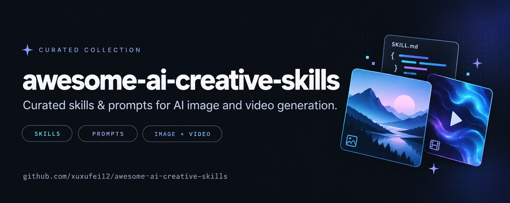

# Awesome AI Creative Skills

[English](README.md) · [简体中文](README.zh-CN.md)

> 把想法变成视频、图像、动效和三维世界的 Skill、Prompt、工具与作品资料库。

 

这里收录了一些用 AI 制作创意图片、视频、动效和 3D 场景的方法，包括可直接参考的提示词、可复用的 Skill，以及对应的作品效果。从一张有趣的图片到一段完整的动画，希望你能在这里找到灵感，也找到动手创作的起点。

**资料快照: 2026-10-23** · **441** 项目 · **772** Skills · **1834** 提示词／风格文本 · **2203** 案例

## 开始浏览

| 入口 | 内容 |
|---|---|
| [完整分类目录](catalog/README.md) | 14 个创作方向 |
| [提示词正文](catalog/prompts/README.md) | 可复制正文、来源与对应效果 |
| [Skill 原文](catalog/skills/README.md) | 独立 Skill 页面与上游安装依赖 |
| [案例与效果](catalog/cases/README.md) | 预览图、视频与公开提示词状态 |
| [工作流与原创模板](catalog/guides.md) | 社区教程与原创模板分别标注 |
| [PDF 合并记录](docs/PDF-MERGE.md) | 页码、去重映射与新增仓库 |

## 效果画廊

先看看这些创意能做成什么样。点击图片或标题，查看提示词、制作方法和作者来源；视频案例的详情页还提供播放入口。

### 创意图片与视觉想象

<table>
<tr>
<td width="33%" valign="top" align="center"> <a href="prompts/bbb05d8c5c1fd2f7.md"><b>城市美食地图</b></a> <a href="https://github.com/YouMind-OpenLab/awesome-gpt-image-2/blob/e370b74e0d465dd72607b19ca0590735a08f927d/README.md#L236">YouMind-OpenLab/awesome-gpt-image-2</a></td>
<td width="33%" valign="top" align="center"> <a href="prompts/82b5eeb6e0f590d3.md"><b>蓬松毛绒玩具</b></a> <a href="https://github.com/PicoTrex/Awesome-Nano-Banana-images/blob/2558bf0bb825be150c5d1aeab918cd90004882d3/README.md#L513">PicoTrex/Awesome-Nano-Banana-images</a></td>
<td width="33%" valign="top" align="center"> <a href="prompts/02656caaa655f456.md"><b>浮世绘闪卡</b></a> <a href="https://github.com/PicoTrex/Awesome-Nano-Banana-images/blob/2558bf0bb825be150c5d1aeab918cd90004882d3/README.md#L224">PicoTrex/Awesome-Nano-Banana-images</a></td>
</tr>
<tr>
<td width="33%" valign="top" align="center"> <a href="prompts/651e78dab7a4f399.md"><b>丝绸宇宙</b></a> <a href="https://github.com/jamez-bondos/awesome-gpt4o-images/blob/3ed4dbb0f1ae6f7385c81e1fcea48d9eefd2e596/README.md#L1043">jamez-bondos/awesome-gpt4o-images</a></td>
<td width="33%" valign="top" align="center"> <a href="prompts/7b0f59ebdaae14ea.md"><b>冰棒里的水下世界</b></a> <a href="https://github.com/jamez-bondos/awesome-gpt4o-images/blob/3ed4dbb0f1ae6f7385c81e1fcea48d9eefd2e596/README.md#L1066">jamez-bondos/awesome-gpt4o-images</a></td>
<td width="33%" valign="top" align="center"> <a href="prompts/e24095a21fad2a6e.md"><b>蒸汽朋克机械鱼</b></a> <a href="https://github.com/jamez-bondos/awesome-gpt4o-images/blob/3ed4dbb0f1ae6f7385c81e1fcea48d9eefd2e596/README.md#L1087">jamez-bondos/awesome-gpt4o-images</a></td>
</tr>
<tr>
<td width="33%" valign="top" align="center"> <a href="prompts/c59d105455d72b08.md"><b>城市冰箱贴</b></a> <a href="https://github.com/PicoTrex/Awesome-Nano-Banana-images/blob/2558bf0bb825be150c5d1aeab918cd90004882d3/README.md#L1004">PicoTrex/Awesome-Nano-Banana-images</a></td>
<td width="33%" valign="top" align="center"> <a href="prompts/1866c6c531688d17.md"><b>Q 版微缩概念店</b></a> <a href="https://github.com/PicoTrex/Awesome-Nano-Banana-images/blob/2558bf0bb825be150c5d1aeab918cd90004882d3/README.md#L1064">PicoTrex/Awesome-Nano-Banana-images</a></td>
<td width="33%" valign="top" align="center"> <a href="prompts/95e4062ca861fd15.md"><b>水晶质感 Emoji</b></a> <a href="https://github.com/PicoTrex/Awesome-Nano-Banana-images/blob/2558bf0bb825be150c5d1aeab918cd90004882d3/README.md#L526">PicoTrex/Awesome-Nano-Banana-images</a></td>
</tr>
</table>

### 视频动效与艺术风格

<table>
<tr>
<td width="33%" valign="top" align="center"> <a href="prompts/439b80af58d8a21c.md"><b>水墨动画</b></a> <a href="https://github.com/lemomo-ai/lemo-opuscar/blob/b5e8ef93930b6d828f352055a689320f138237b1/styles/ink-wash/STYLE.md">lemomo-ai/lemo-opuscar</a></td>
<td width="33%" valign="top" align="center"> <a href="prompts/7dc5461235480db1.md"><b>红色剪纸</b></a> <a href="https://github.com/lemomo-ai/lemo-opuscar/blob/b5e8ef93930b6d828f352055a689320f138237b1/styles/papercut-red/STYLE.md">lemomo-ai/lemo-opuscar</a></td>
<td width="33%" valign="top" align="center"> <a href="prompts/1bcdae4068414785.md"><b>彩色玻璃</b></a> <a href="https://github.com/lemomo-ai/lemo-opuscar/blob/b5e8ef93930b6d828f352055a689320f138237b1/styles/stained-glass/STYLE.md">lemomo-ai/lemo-opuscar</a></td>
</tr>
<tr>
<td width="33%" valign="top" align="center"> <a href="prompts/0fea92b82962c4cf.md"><b>像素 RPG</b></a> <a href="https://github.com/lemomo-ai/lemo-opuscar/blob/b5e8ef93930b6d828f352055a689320f138237b1/styles/pixel-rpg/STYLE.md">lemomo-ai/lemo-opuscar</a></td>
<td width="33%" valign="top" align="center"> <a href="prompts/263c12d283578967.md"><b>80 年代赛璐璐动画</b></a> <a href="https://github.com/lemomo-ai/lemo-opuscar/blob/b5e8ef93930b6d828f352055a689320f138237b1/styles/cel-anime-80s/STYLE.md">lemomo-ai/lemo-opuscar</a></td>
<td width="33%" valign="top" align="center"> <a href="prompts/983c7c261e3a2fa6.md"><b>流体动效</b></a> <a href="https://github.com/Vincentwei1021/mg-styles-15/blob/49052d80bfaf9fa8412cc9710530e5e95a3b8d8c/prompts/07-liquid.md">Vincentwei1021/mg-styles-15</a></td>
</tr>
<tr>
<td width="33%" valign="top" align="center"> <a href="prompts/e265b24054768d7c.md"><b>合成波霓虹</b></a> <a href="https://github.com/Vincentwei1021/mg-styles-15/blob/49052d80bfaf9fa8412cc9710530e5e95a3b8d8c/prompts/10-synthwave.md">Vincentwei1021/mg-styles-15</a></td>
<td width="33%" valign="top" align="center"> <a href="prompts/eae464bef64d2152.md"><b>包豪斯几何</b></a> <a href="https://github.com/Vincentwei1021/mg-styles-15/blob/49052d80bfaf9fa8412cc9710530e5e95a3b8d8c/prompts/09-bauhaus.md">Vincentwei1021/mg-styles-15</a></td>
<td width="33%" valign="top" align="center"> <a href="prompts/c2f7e801155baaca.md"><b>拼贴动画</b></a> <a href="https://github.com/Vincentwei1021/mg-styles-15/blob/49052d80bfaf9fa8412cc9710530e5e95a3b8d8c/prompts/06-collage.md">Vincentwei1021/mg-styles-15</a></td>
</tr>
</table>

### 3D 世界与产品视觉

<table>
<tr>
<td width="33%" valign="top" align="center"> <a href="prompts/4c3d0578ad2c9a67.md"><b>低多边形岛屿</b></a> <a href="https://github.com/lemomo-ai/lemo-opuscar/blob/b5e8ef93930b6d828f352055a689320f138237b1/styles/lowpoly-island/STYLE.md">lemomo-ai/lemo-opuscar</a></td>
<td width="33%" valign="top" align="center"> <a href="prompts/2835b8b29667bdc4.md"><b>积木玩具世界</b></a> <a href="https://github.com/lemomo-ai/lemo-opuscar/blob/b5e8ef93930b6d828f352055a689320f138237b1/styles/brick-toy/STYLE.md">lemomo-ai/lemo-opuscar</a></td>
<td width="33%" valign="top" align="center"> <a href="prompts/06f4c5f7855f2517.md"><b>等距信息图</b></a> <a href="https://github.com/lemomo-ai/lemo-opuscar/blob/b5e8ef93930b6d828f352055a689320f138237b1/styles/iso-infographic/STYLE.md">lemomo-ai/lemo-opuscar</a></td>
</tr>
<tr>
<td width="33%" valign="top" align="center"> <a href="prompts/13f6af1730ea3945.md"><b>玻璃产品视觉</b></a> <a href="https://github.com/lemomo-ai/lemo-opuscar/blob/b5e8ef93930b6d828f352055a689320f138237b1/styles/glass-product/STYLE.md">lemomo-ai/lemo-opuscar</a></td>
<td width="33%" valign="top" align="center"> <a href="prompts/d36c4e7f3c8effa1.md"><b>VR 头显爆炸图</b></a> <a href="https://github.com/YouMind-OpenLab/awesome-gpt-image-2/blob/e370b74e0d465dd72607b19ca0590735a08f927d/README.md#L167">YouMind-OpenLab/awesome-gpt-image-2</a></td>
<td width="33%" valign="top" align="center"> <a href="prompts/94c4c40dc1cb70fa.md"><b>3D 石阶演化</b></a> <a href="https://github.com/YouMind-OpenLab/awesome-gpt-image-2/blob/e370b74e0d465dd72607b19ca0590735a08f927d/README.md#L462">YouMind-OpenLab/awesome-gpt-image-2</a></td>
</tr>
<tr>
<td width="33%" valign="top" align="center"> <a href="prompts/66e353f9ceb6bb06.md"><b>3D 产品动效</b></a> <a href="https://github.com/Vincentwei1021/mg-styles-15/blob/49052d80bfaf9fa8412cc9710530e5e95a3b8d8c/prompts/04-3d-render.md">Vincentwei1021/mg-styles-15</a></td>
<td width="33%" valign="top" align="center"> <a href="prompts/08fb0f0ea3d83e3a.md"><b>等距微缩城市</b></a> <a href="https://github.com/Vincentwei1021/mg-styles-15/blob/49052d80bfaf9fa8412cc9710530e5e95a3b8d8c/prompts/03-isometric.md">Vincentwei1021/mg-styles-15</a></td>
<td width="33%" valign="top" align="center"> <a href="prompts/5952846d57e64b16.md"><b>迷你 3D 建筑</b></a> <a href="https://github.com/jamez-bondos/awesome-gpt4o-images/blob/3ed4dbb0f1ae6f7385c81e1fcea48d9eefd2e596/README.md#L1270">jamez-bondos/awesome-gpt4o-images</a></td>
</tr>
</table>

## 重点项目

| Project | 方向 |
|---|---|
| [alchaincyf/huashu-motion](projects/alchaincyf--huashu-motion.md) | 广告与产品演示 |
| [alchaincyf/huashu-art-motion](projects/alchaincyf--huashu-art-motion.md) | 教学科普与手绘 |
| [Kianzzz/xilo-opus-video](projects/kianzzz--xilo-opus-video.md) | 广告与产品演示 |
| [threerocks/sweety-handdraw-video](projects/threerocks--sweety-handdraw-video.md) | 教学科普与手绘 |
| [remotion-dev/skills](projects/remotion-dev--skills.md) | 视频框架与程序化成片 |
| [heygen-com/hyperframes](projects/heygen-com--hyperframes.md) | 视频框架与程序化成片 |
| [lemomo-ai/lemo-opuscar](projects/lemomo-ai--lemo-opuscar.md) | 合集与创作案例 |
| [cth9191/animate](projects/cth9191--animate.md) | 广告与产品演示 |
| [op7418/guizang-product-video-skill](projects/op7418--guizang-product-video-skill.md) | 广告与产品演示 |
| [dexhunter/seedance2-skill](projects/dexhunter--seedance2-skill.md) | 提示词与导演方法 |
| [eternityspring/shuohao-skills](projects/eternityspring--shuohao-skills.md) | 广告与产品演示 |
| [ahujasid/mcp-for-blender](projects/ahujasid--mcp-for-blender.md) | Blender 与三维建模 |
| [MCKRUZ/ComfyUI-Expert](projects/mckruz--comfyui-expert.md) | ComfyUI 与模型编排 |
| [yihui-dev/awesome-opus5-5-videos](projects/yihui-dev--awesome-opus5-5-videos.md) | 提示词与导演方法 |
| [joeseesun/opus-video-prompts](projects/joeseesun--opus-video-prompts.md) | 提示词与导演方法 |
| [Vincentwei1021/mg-styles-15](projects/vincentwei1021--mg-styles-15.md) | 提示词与导演方法 |

## 按方向查找

| 方向 | 项目数 |
|---|---:|
| [教学科普与手绘](catalog/education.md) | 62 |
| [剪辑字幕与数字人](catalog/editing.md) | 94 |
| [叙事动画与音乐视频](catalog/storytelling.md) | 30 |
| [视频框架与程序化成片](catalog/video-frameworks.md) | 68 |
| [广告与产品演示](catalog/product-videos.md) | 69 |
| [SVG 与动态图形](catalog/motion-graphics.md) | 30 |
| [提示词与导演方法](catalog/directing.md) | 26 |
| [Blender 与三维建模](catalog/blender.md) | 11 |
| [Three.js 与 WebGPU](catalog/web-3d.md) | 7 |
| [图像生成与商业视觉](catalog/image-generation.md) | 16 |
| [合集与创作案例](catalog/collections.md) | 10 |
| [ComfyUI 与模型编排](catalog/comfyui.md) | 5 |
| [游戏资产与像素画](catalog/game-assets.md) | 11 |
| [高斯泼溅与仿真](catalog/simulation.md) | 2 |

## 如何使用

1. 先按用途选项目，再打开对应的 Skill 或提示词。
2. 核对原始来源、许可证、依赖和输入素材；宿主标签只表示来源提及。
3. 先做静帧或 5–10 秒小样，再扩大到完整作品。
4. 作品效果属于上游作者；缺少公开正文、效果或复现证据的条目会明确说明。

## 来源与维护

- [Methodology / 收录方法](docs/METHODOLOGY.md)
- [Attribution & licenses / 来源与许可](THIRD_PARTY_NOTICES.md)
- [Contribute / 参与贡献](CONTRIBUTING.md)
- [Machine-readable catalogue / 结构化数据](data/catalog.json)
- [Validation report / 检查报告](docs/VALIDATION.md)

## Star History / Star 趋势

新仓库需要积累 Star 后才会形成曲线；图表由 Star History 动态提供。项目详情页也有各上游仓库的趋势入口。
